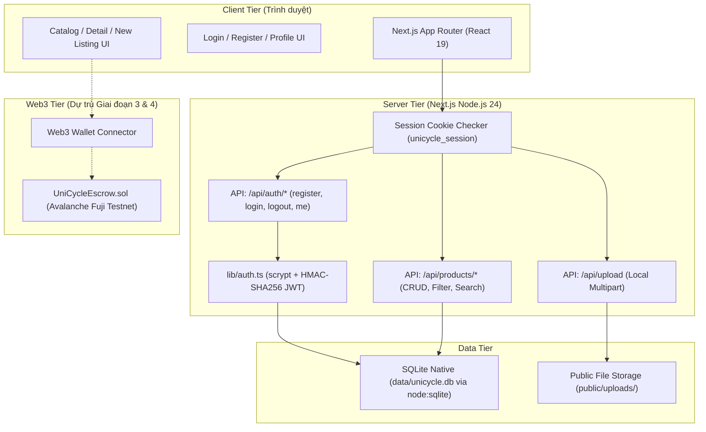
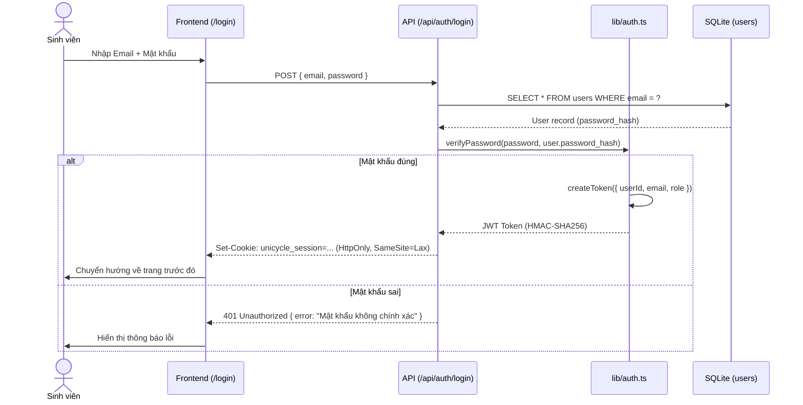

# UniCycle – Tài Liệu Kiến Trúc Kỹ Thuật (Architecture & Debugging Guide)

Tài liệu này mô tả chi tiết toàn bộ kiến trúc phần mềm của dự án **UniCycle**, cấu trúc thư mục, luồng dữ liệu (Data Flow), thiết kế cơ sở dữ liệu và **hướng dẫn gỡ lỗi (Debugging Guide)** để dễ dàng vận hành và bảo trì trong suốt quá trình phát triển đồ án.

---

## 1. Sơ đồ Kiến trúc Tổng quan (System Overview)

UniCycle được xây dựng theo mô hình **Next.js 16 App Router (Fullstack)** kết hợp giữa **Off-chain Core** (Database cục bộ tốc độ cao) và sẵn sàng tích hợp **On-chain Layer** (Avalanche C-Chain Smart Escrow) ở các giai đoạn sau:



---

## 2. Các Boundary Ổn Định Của Hệ Thống (Stable Architecture Boundaries)

Sơ đồ dưới đây chỉ giữ lại những thư mục và file gốc có ý nghĩa về mặt kiến trúc. Không liệt kê từng route, page hoặc component cụ thể vì chúng sẽ thay đổi thường xuyên khi sản phẩm mở rộng.

```text
unicycle/
├── app/                  # Presentation & routing: pages, layouts, route handlers
├── components/           # Shared UI và các component theo domain
├── lib/                  # Core services, domain logic, auth và database access
├── data/                 # Persistence boundary: dữ liệu SQLite local
├── public/               # Static assets và media được phục vụ trực tiếp
├── docs/                 # Architecture, design system và product documentation
├── contracts/            # Web3 boundary (dự kiến ở các phase sau)
├── package.json          # Dependency và scripts của ứng dụng
├── next.config.ts        # Cấu hình framework/build
└── tsconfig.json         # Ràng buộc TypeScript
```

### Nguyên tắc phụ thuộc:
1. **`app/` và `components/`** chỉ hiển thị và điều phối tương tác; không truy cập SQLite trực tiếp.
2. **`lib/`** là boundary ổn định cho nghiệp vụ, xác thực và truy cập dữ liệu. Có thể thay UI hoặc storage mà không làm thay đổi contract của tầng này.
3. **`data/` và `public/`** là các boundary lưu trữ có thể thay thế hoặc chuyển sang dịch vụ bên ngoài mà không lan logic vào tầng giao diện.
4. **`contracts/`** chỉ giao tiếp với ứng dụng qua một integration layer riêng khi Web3 được triển khai.

---

## 3. Thiết kế Cơ sở dữ liệu (Database Schema)

Cơ sở dữ liệu được quản lý tự động bởi `lib/db.ts` với chế độ `PRAGMA journal_mode = WAL` và `PRAGMA foreign_keys = ON`:

```sql
-- 1. Người dùng (Sinh viên)
CREATE TABLE users (
  id TEXT PRIMARY KEY,
  email TEXT UNIQUE NOT NULL,
  password_hash TEXT NOT NULL,
  full_name TEXT NOT NULL,
  phone TEXT,
  university TEXT,
  campus_location TEXT,
  avatar_url TEXT,
  bio TEXT,
  wallet_address TEXT,           -- Dành cho GĐ 3 (Ví Web3 MetaMask)
  role TEXT DEFAULT 'USER',       -- USER | ADMIN
  created_at TEXT NOT NULL,
  updated_at TEXT NOT NULL
);

-- 2. Danh mục sản phẩm (Đa danh mục)
CREATE TABLE categories (
  id TEXT PRIMARY KEY,
  name TEXT UNIQUE NOT NULL,
  slug TEXT UNIQUE NOT NULL,
  description TEXT,
  icon TEXT NOT NULL,
  display_order INTEGER DEFAULT 0,
  created_at TEXT NOT NULL
);

-- 3. Sản phẩm đồ cũ
CREATE TABLE products (
  id TEXT PRIMARY KEY,
  title TEXT NOT NULL,
  slug TEXT UNIQUE NOT NULL,
  description TEXT NOT NULL,
  price REAL NOT NULL,
  condition TEXT NOT NULL,       -- NEW | LIKE_NEW | GOOD | FAIR | POOR
  status TEXT DEFAULT 'ACTIVE',  -- ACTIVE | RESERVED | SOLD | HIDDEN
  category_id TEXT NOT NULL,
  seller_id TEXT NOT NULL,
  pickup_location TEXT NOT NULL,
  attributes TEXT,               -- JSON lưu thuộc tính động theo danh mục
  passport_hash TEXT,            -- Mã SHA-256 xác thực tình trạng (GĐ 2)
  view_count INTEGER DEFAULT 0,
  created_at TEXT NOT NULL,
  updated_at TEXT NOT NULL,
  FOREIGN KEY (category_id) REFERENCES categories (id),
  FOREIGN KEY (seller_id) REFERENCES users (id)
);

-- 4. Hình ảnh chi tiết của sản phẩm
CREATE TABLE product_images (
  id TEXT PRIMARY KEY,
  product_id TEXT NOT NULL,
  url TEXT NOT NULL,
  is_cover INTEGER DEFAULT 0,
  display_order INTEGER DEFAULT 0,
  created_at TEXT NOT NULL,
  FOREIGN KEY (product_id) REFERENCES products (id) ON DELETE CASCADE
);
```

---

## 4. Cơ chế Xác thực & Session (Authentication Flow)



---

## 5. Hướng dẫn Gỡ lỗi & Kiểm tra (Debugging Guide)

### 5.1. Kiểm tra trực tiếp Cơ sở dữ liệu SQLite
Bạn có thể chạy lệnh một dòng sau trong PowerShell/Terminal để kiểm tra dữ liệu hiện tại trong DB:

```powershell
node -e "
const { DatabaseSync } = require('node:sqlite');
const db = new DatabaseSync('data/unicycle.db');
console.log('Categories:', db.prepare('SELECT count(*) as c FROM categories').get());
console.log('Users:', db.prepare('SELECT id, email, full_name FROM users').all());
console.log('Products:', db.prepare('SELECT id, title, price, status FROM products').all());
"
```

### 5.2. Reset lại dữ liệu mẫu (Re-seed Database)
Nếu muốn làm mới lại dữ liệu từ đầu, chỉ cần xóa file `data/unicycle.db`. Khi server Next.js chạy lại, `lib/db.ts` sẽ tự động khởi tạo lại cấu trúc và nạp lại dữ liệu mẫu:
```powershell
Remove-Item -Force data\unicycle.db*
```

### 5.3. Kiểm tra Session Cookie hiện tại
- Mở DevTools trên trình duyệt (F12) → Tab **Application** (hoặc **Storage**) → Mục **Cookies** → `http://localhost:3000`.
- Kiểm tra cookie `unicycle_session` có tồn tại hay không.
- Nếu muốn đăng xuất thủ công, có thể xóa cookie này hoặc bấm nút Đăng xuất trên menu tài khoản.

### 5.4. Lỗi thường gặp và cách xử lý
1. **Lỗi EPERM khi build hoặc chạy dev server trên Windows**:
   - Nguyên nhân: File cache `.next` bị một tiến trình Node khác giữ khóa.
   - Khắc phục: Tắt các terminal Node đang chạy ngầm và chạy lại lệnh.
2. **Lỗi kết nối font Google khi offline**:
   - Dự án đã được cấu hình font hệ thống trong `app/layout.tsx` nên hoàn toàn không phụ thuộc kết nối Internet đến `fonts.googleapis.com`.
