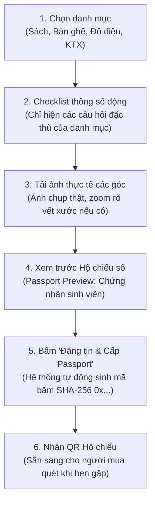
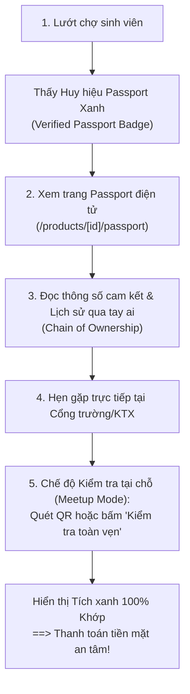

# Thiết kế Luồng Trải Nghiệm (User Flow) Giai đoạn 2: UniCycle Passport
*(Ứng dụng tiêu chuẩn UI/UX Pro Max: Pattern Trust & Authority, Progressive Disclosure & Cognitive Ergonomics)*

# **Thiết kế Luồng Trải Nghiệm (User Flow) Giai đoạn 2: UniCycle Passport**

## 1. Vấn đề cốt lõi & Tư duy Thiết kế (Design Thinking)

Trong các giao dịch đồ cũ sinh viên, rào cản lớn nhất là **SỰ NGHI NGẠI**:
- Người mua sợ ảnh trên mạng là ảnh mạng hoặc đã qua chỉnh sửa, khi nhận đồ ở cổng trường thì phát hiện bị nứt, gãy, thiếu phụ kiện hoặc sách bị rách trang.
- Các thuật ngữ kỹ thuật như *"Mã băm SHA-256", "bytes32"* sẽ gây khó hiểu cho sinh viên nếu không được "dịch" thành **giao diện trực quan, dễ dùng và tạo cảm giác an tâm tuyệt đối**.

## **1. Vấn đề cốt lõi & Tư duy Thiết kế (Design Thinking)**

## 2. Bản đồ 2 Luồng Trải nghiệm Người dùng (Dual User Flows)

### 🅰️ Luồng Người bán (Seller Flow: "Đăng đồ minh bạch – Tự hào uy tín")

#### Tối ưu hóa UI/UX cho Người bán (Progressive Disclosure):
1. **Không làm form dài vô tận**: Chỉ khi người bán chọn *"Giáo trình"*, form mới mở ra 3 câu hỏi nhanh dạng chip:
   - *Tình trạng viết vẽ:* [Không viết vẽ] / [Có bút chì gôm được] / [Highlight nhiều].
   - *Độ nguyên vẹn trang:* [Đủ 100% trang] / [Có vài trang long gáy].
2. **Khuyến khích trung thực thay vì che giấu khuyết điểm**:
   - Gợi ý UI: *"Mô tả trung thực vết xước giúp bạn nhận huy hiệu Người bán Trung thực và đồ được thanh lý nhanh hơn 3 lần."*
3. **Passport Preview Modal**: Trước khi đăng, người bán thấy ngay thẻ Passport lấp lánh mang tên mình, tạo cảm giác tự hào và có trách nhiệm với món đồ.

---

### 🅱️ Luồng Người mua (Buyer Flow: "Kiểm tra nguồn gốc – Chế độ soi đồ tại cổng trường")

#### Tối ưu hóa UI/UX cho Người mua (Trust & Authority):
1. **Thẻ Chứng nhận Hộ chiếu Số (Digital Passport Card)**:
   - Thiết kế như một tấm thẻ sinh viên cao cấp với viền bo góc tròn mềm mại (`rounded-3xl`), dải nền hoa văn bảo mật chống làm giả, mã băm rút gọn kèm nút copy 1 chạm.
2. **Chế độ Kiểm tra tại chỗ (Meetup Verification Mode)**:
   - Tại buổi gặp mặt giao đồ ở KTX/Cổng trường, người mua mở trang Passport trên điện thoại hoặc quét mã QR từ máy người bán.
   - Nút **"Kiểm tra tính toàn vẹn"**: Chạy hiệu ứng radar quét trong 0.4s -> Bật thông báo tích xanh: *"Ảnh và thông số hoàn toàn trùng khớp với dữ liệu gốc lúc đăng tin - Không bị can thiệp."*
3. **Cây Lịch sử Tuần hoàn Sinh viên (Chain of Ownership Timeline)**:
   - Hiển thị câu chuyện món đồ:
     - 🎓 *Khởi tạo*: K19 Bách Khoa mua mới.
     - 🔄 *Chuyền tay*: K21 Khoa học Tự nhiên nhận lại.
     - 🌟 *Thế hệ tiếp theo*: Dành cho bạn!
   - Biến việc mua đồ cũ thành hành động văn minh: **tiết kiệm tiền và bảo vệ môi trường**.

## **2. Bản đồ 2 Luồng Trải nghiệm Người dùng (Dual User Flows)**

## 3. Quy chuẩn Thiết kế Giao diện (Design Tokens & Component Specs)

Bám sát bảng màu 5 sắc thái xanh chủ đạo:
- **Thẻ Hộ chiếu chính**: Nền `#001B48` (Midnight Navy) với chữ trắng và viền gradient xanh `#018ABE` tạo sự uy tín như văn bằng chứng nhận.
- **Huy hiệu Verified**: Nền `#D6E8EE` chữ `#001B48` viền `#97CADB` tạo cảm giác mát mắt, tin cậy.
- **Trạng thái Khớp toàn vẹn (Integrity Matched)**: Icon khiên `#018ABE` kết hợp vòng sáng nhẹ `#97CADB`.
- **Icon**: Toàn bộ dùng vector SVG từ `components/icons.tsx` (thay vì emoji).

---

## 4. Kế hoạch chia nhỏ 5 Task triển khai (Atomic Tasks)

- [x] **Task 2.1: Bộ Engine băm Passport SHA-256 (`lib/passport.ts`) & Cập nhật Dữ liệu Seed**
  - Tạo engine băm chuẩn hóa JSON ra định dạng `0x...` `bytes32`.
  - Cập nhật 6 sản phẩm mẫu trong DB kèm thông số Passport thực tế.
- [ ] **Task 2.2: Form Đăng tin thông minh với Checklist động theo Danh mục**
  - Tích hợp bộ câu hỏi nhanh cho từng danh mục (Sách, Bàn ghế, Đồ điện, KTX).
  - Tự động sinh `passport_hash` khi sinh viên đăng bài hoặc cập nhật bài đăng.
- [ ] **Task 2.3: Trang Chứng nhận Hộ chiếu điện tử (`/products/[id]/passport`)**
  - Thiết kế thẻ Passport số cao cấp, mã QR tương tác, hiển thị thông số gốc.
  - Công cụ tương tác trực tiếp: Bấm nút "Kiểm tra tính toàn vẹn (Verify)".
- [ ] **Task 2.4: Cây Lịch sử Tuần hoàn Sở hữu & Nút mở Passport trên trang Chi tiết**
  - Thiết kế Timeline các thế hệ sinh viên đã sở hữu món đồ.
  - Đặt nút bấm/badge mở Passport nổi bật trên trang `/products/[id]`.
- [ ] **Task 2.5: API Xác thực Độc lập (`/api/passport/verify`)**
  - Cung cấp endpoint tra cứu Passport nhanh cho thiết bị di động hoặc ví Web3.

#### **Tối ưu hóa UI/UX cho Người bán (Progressive Disclosure):**

1.  **Không làm form dài vô tận**: Chỉ khi người bán chọn *"Giáo
    trình"*, form mới mở ra 3 câu hỏi nhanh dạng chip:  
    -   *Tình trạng viết vẽ:* \[Không viết vẽ\] / \[Có bút chì gôm
        được\] / \[Highlight nhiều\].
    -   *Độ nguyên vẹn trang:* \[Đủ 100% trang\] / \[Có vài trang long
        gáy\].
2.  **Khuyến khích trung thực thay vì che giấu khuyết điểm**:  
    -   Gợi ý UI: *"Mô tả trung thực vết xước giúp bạn nhận huy hiệu
        Người bán Trung thực và đồ được thanh lý nhanh hơn 3 lần."*
3.  **Passport Preview Modal**: Trước khi đăng, người bán thấy ngay thẻ
    Passport lấp lánh mang tên mình, tạo cảm giác tự hào và có trách
    nhiệm với món đồ.

------------------------------------------------------------------------

### **🅱️ Luồng Người mua (Buyer Flow: "Kiểm tra nguồn gốc -- Chế độ soi đồ tại cổng trường")**

Mermaid diagram

#### **Tối ưu hóa UI/UX cho Người mua (Trust & Authority):**

1.  **Thẻ Chứng nhận Hộ chiếu Số (Digital Passport Card)**:  
    -   Thiết kế như một tấm thẻ sinh viên cao cấp với viền bo góc tròn
        mềm mại (`rounded-3xl`), dải nền hoa văn bảo mật chống làm giả,
        mã băm rút gọn kèm nút copy 1 chạm.
2.  **Chế độ Kiểm tra tại chỗ (Meetup Verification Mode)**:  
    -   Tại buổi gặp mặt giao đồ ở KTX/Cổng trường, người mua mở trang
        Passport trên điện thoại hoặc quét mã QR từ máy người bán.
    -   Nút **"Kiểm tra tính toàn vẹn"**: Chạy hiệu ứng radar quét trong
        0.4s -\> Bật thông báo tích xanh: *"Ảnh và thông số hoàn toàn
        trùng khớp với dữ liệu gốc lúc đăng tin - Không bị can thiệp."*
3.  **Cây Lịch sử Tuần hoàn Sinh viên (Chain of Ownership Timeline)**:  
    -   Hiển thị câu chuyện món đồ:  
        -   🎓 *Khởi tạo*: K19 Bách Khoa mua mới.
        -   🔄 *Chuyền tay*: K21 Khoa học Tự nhiên nhận lại.
        -   🌟 *Thế hệ tiếp theo*: Dành cho bạn!
    -   Biến việc mua đồ cũ thành hành động văn minh: **tiết kiệm tiền
        và bảo vệ môi trường**.

------------------------------------------------------------------------

## **3. Quy chuẩn Thiết kế Giao diện (Design Tokens & Component Specs)**

Bám sát bảng màu 5 sắc thái xanh chủ đạo:

-   **Thẻ Hộ chiếu chính**: Nền `#001B48` (Midnight Navy) với chữ trắng
    và viền gradient xanh `#018ABE` tạo sự uy tín như văn bằng chứng
    nhận.
-   **Huy hiệu Verified**: Nền `#D6E8EE` chữ `#001B48` viền `#97CADB`
    tạo cảm giác mát mắt, tin cậy.
-   **Trạng thái Khớp toàn vẹn (Integrity Matched)**: Icon khiên
    `#018ABE` kết hợp vòng sáng nhẹ `#97CADB`.
-   **Icon**: Toàn bộ dùng vector SVG từ `components/icons.tsx` (thay vì
    emoji).

------------------------------------------------------------------------

## **4. Kế hoạch chia nhỏ 5 Task triển khai (Atomic Tasks)**

### 🔹 **Task 2.1: Bộ Engine băm Passport SHA-256 (`lib/passport.ts`) & Cập nhật Dữ liệu Seed**

-   Tạo engine băm chuẩn hóa JSON ra định dạng `0x...` `bytes32`.
-   Cập nhật 6 sản phẩm mẫu trong DB kèm thông số Passport thực tế.

### 🔹 **Task 2.2: Form Đăng tin thông minh với Checklist động theo Danh mục**

-   Tích hợp bộ câu hỏi nhanh cho từng danh mục (Sách, Bàn ghế, Đồ điện,
    KTX).
-   Tự động sinh `passport_hash` khi sinh viên đăng bài.

### 🔹 **Task 2.3: Trang Chứng nhận Hộ chiếu điện tử (`/products/[id]/passport`)**

-   Thiết kế thẻ Passport số cao cấp, mã QR tương tác, hiển thị thông số
    gốc.
-   Công cụ tương tác trực tiếp: Bấm nút "Kiểm tra tính toàn vẹn
    (Verify)".

### 🔹 **Task 2.4: Cây Lịch sử Tuần hoàn Sở hữu & Nút mở Passport trên trang Chi tiết**

-   Thiết kế Timeline các thế hệ sinh viên đã sở hữu món đồ.
-   Đặt nút bấm/badge mở Passport nổi bật trên trang `/products/[id]`.

### 🔹 **Task 2.5: API Xác thực Độc lập (`/api/passport/verify`)**

-   Cung cấp endpoint tra cứu Passport nhanh cho thiết bị di động hoặc
    ví Web3.
