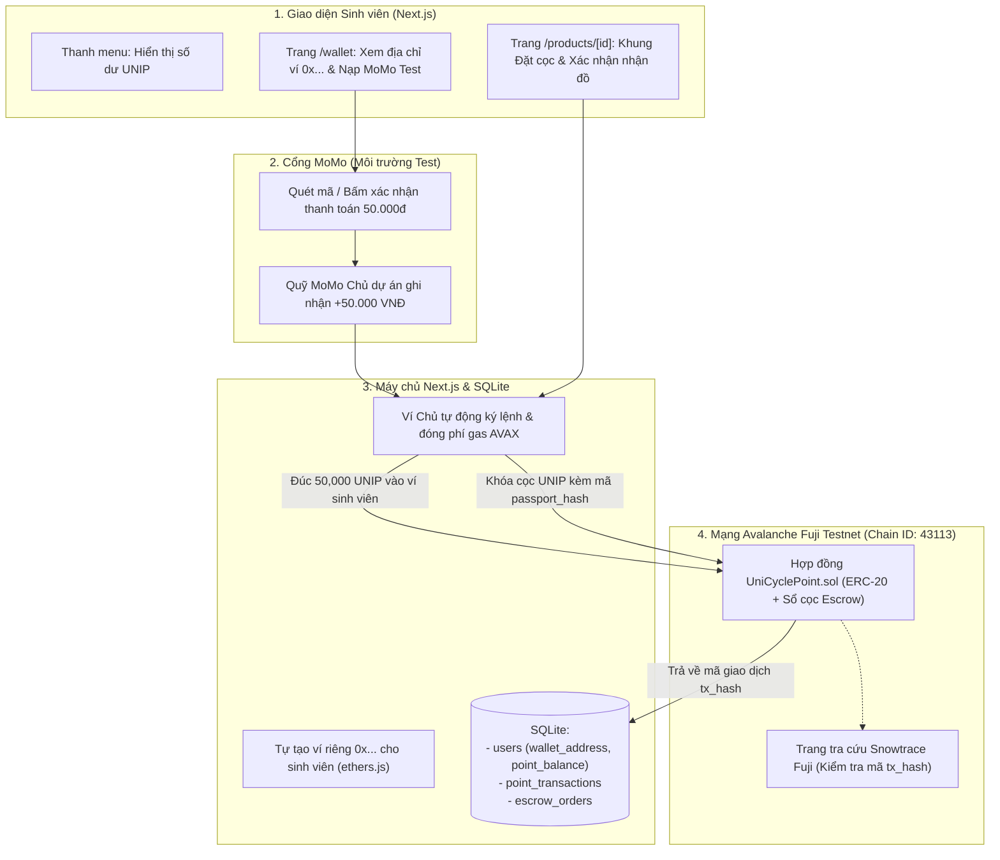

# Kế hoạch Giai đoạn 3: Ví UniCycle, Đồng UniPoint (UNIP) và Đặt cọc An toàn

Tài liệu này mô tả cách UniCycle tích hợp thanh toán MoMo môi trường test và lưu dấu vết giao dịch lên mạng Avalanche Fuji Testnet. Mục tiêu của giai đoạn 3 là giúp sinh viên mua bán đồ cũ thuận tiện như dùng ví điện tử thông thường, trong khi mọi biến động điểm và lịch sử sang tên món đồ đều có biên lai đối chiếu công khai trên Blockchain.

## 1. Quy ước dòng tiền và đồng Point (1 VNĐ = 1 UNIP)

Để bạn và giám khảo dễ theo dõi, hệ thống tách bạch 2 lớp dữ liệu chạy song song:

| Loại tài sản | Nằm ở đâu? | Vai trò trong ứng dụng |
| :--- | :--- | :--- |
| **Tiền VNĐ (MoMo Test)** | Tài khoản MoMo chủ của dự án (Merchant) | Khi sinh viên nạp 50.000đ qua MoMo Test, khoản tiền này ghi nhận về tài khoản chủ của dự án để làm quỹ bảo chứng. Vì dùng môi trường test nên không trừ tiền thật của bạn. |
| **Đồng `UNIP` (UniPoint)** | Ví Blockchain riêng (`0x...`) của từng sinh viên trên Avalanche Fuji | Ngay khi MoMo báo nhận 50.000đ thành công, hệ thống tự đúc (`mint`) `50,000 UNIP` bỏ vào ví riêng của sinh viên đó để dùng đặt cọc mua đồ và lưu vết trên Blockchain. |
| **Phí mạng lưới (AVAX Testnet)** | Ví Chủ kỹ thuật (Master Wallet của bạn) | Mạng Avalanche yêu cầu một lượng nhỏ AVAX làm phí ghi dữ liệu. Bạn lấy sẵn 2 AVAX miễn phí từ trang Faucet bỏ vào Ví Chủ để hệ thống tự trả phí hộ cho sinh viên. |

## 2. Sơ đồ kiến trúc hệ thống



## 3. Thiết kế User Flow và Trải nghiệm Giao diện (UI/UX)

Luồng giao diện được thiết kế theo bộ bảng màu xanh của dự án (`#001B48`, `#02457A`, `#018ABE`, `#97CADB`, `#D6E8EE`) trên nền trắng `#FFFFFF`. Sinh viên chỉ thao tác với các nút bấm tiếng Việt quen thuộc, còn thông tin kỹ thuật Blockchain được gom gọn vào khung đối chứng.

```mermaid
sequenceDiagram
    actor Mai as Người mua (Mai)
    participant Web as Giao diện UniCycle
    participantChain as Avalanche Fuji (UNIP)
    actor An as Người bán (An)

    Note over Mai,Web: Bước 1: Mở ví & Nạp điểm (1 VNĐ = 1 UNIP)
    Mai->>Web: Mở trang /wallet (Hệ thống tự tạo ví 0x8A2... cho Mai)
    Mai->>Web: Chọn nạp 50.000đ qua MoMo Test & bấm Xác nhận
    Web->>participantChain: Ví Chủ gọi mintTopup(ví Mai, 50000 UNIP)
    participantChain-->>Web: Trả về tx_hash (Số dư Mai: 50,000 UNIP)

    Note over Mai,An: Bước 2: Đặt cọc giữ chỗ món đồ
    Mai->>Web: Vào trang giáo trình 50.000đ của An, bấm "Đặt cọc giữ chỗ"
    Web->>participantChain: Gọi lockEscrow(50000 UNIP + mã passport_hash)
    participantChain-->>Web: Khóa 50,000 UNIP trong hợp đồng + Trả về lock_tx_hash
    Web-->>An: Bài đăng đổi sang "Đang giữ chỗ" (Khóa nút sửa bài)

    Note over Mai,An: Bước 3: Gặp mặt tại KTX & Giải ngân
    Mai->>An: Gặp tại KTX kiểm tra sách khớp với Sổ đỏ UniCycle Passport
    Mai->>Web: Bấm "Đã nhận đúng hàng - Giải ngân cho người bán"
    Web->>participantChain: Gọi releaseEscrow() chuyển 50,000 UNIP sang ví của An
    participantChain-->>Web: Trả về settle_tx_hash (Số dư An: +50,000 UNIP)
    Web-->>Mai: Tự động ghi tên Mai vào Lịch sử truyền đời (Sổ đỏ sản phẩm)
```

### Chi tiết từng màn hình người dùng sẽ thấy

1. **Trên thanh điều hướng (`Navbar`)**
   - Khi sinh viên đã đăng nhập, cạnh ảnh đại diện có nút hiển thị số dư hiện tại (ví dụ: `Ví: 50.000 UNIP`).
   - Bấm vào nút này sẽ dẫn thẳng tới trang quản lý ví `/wallet`.

2. **Màn hình Ví UniCycle (`/wallet`)**
   - **Thẻ thông tin ví**: Hiển thị số dư `UNIP` lớn, rõ ràng (kèm chú thích `1 UNIP = 1 VNĐ`). Bên dưới là địa chỉ ví riêng `0x...` của sinh viên kèm nút sao chép và link mở trực tiếp trên `testnet.snowtrace.io`.
   - **Khu vực Nạp điểm qua MoMo Test**: Có sẵn 4 nút chọn nhanh mệnh giá sinh viên hay dùng (`20.000đ`, `50.000đ`, `100.000đ`, `200.000đ`). Khi bấm **Thanh toán MoMo Test**, giao diện mở khung mã QR MoMo môi trường test. Sinh viên bấm nút xác nhận giả lập thanh toán thành công, hệ thống hiển thị trạng thái đang đúc coin trên Avalanche rồi cộng điểm ngay kèm mã biên lai `tx_hash`.
   - **Bảng lịch sử giao dịch**: Liệt kê từng lần nạp MoMo, đặt cọc mua hàng, nhận tiền bán hàng và hoàn tiền hủy kèo. Mỗi dòng đều có nút xem chứng từ trên Blockchain.

3. **Khung Đặt cọc trên trang Chi tiết sản phẩm (`/products/[id]`)**
   Khung này nằm ở cột bên phải, ngay dưới dải bảo chứng Sổ đỏ (`PassportTrustBanner`), và tự động thay đổi theo vai trò của người đang xem:

   | Trạng thái món đồ | Giao diện phía Người mua (Mai) | Giao diện phía Người bán (An) |
   | :--- | :--- | :--- |
   | **Đang bán (`ACTIVE`)** | Hiện số dư ví hiện tại và nút **"Đặt cọc giữ chỗ (50.000 UNIP)"**. Nếu ví không đủ điểm, nút tự đổi thành **"Nạp thêm UNIP qua MoMo để đặt cọc"**. | Hiện thông báo món đồ đang mở bán, sẵn sàng nhận đặt cọc qua Smart Contract. |
   | **Đang giữ chỗ (`RESERVED`)** | Hiện thanh tiến trình 3 bước. Có 2 nút hành động: **"Đã nhận đúng đồ (Giải ngân)"** màu xanh đậm và **"Hủy kèo & Nhận lại điểm"** màu xám. | Hiện thông báo *"Bạn Trần Thị Mai đã đặt cọc 50.000 UNIP"*. Nút chỉnh sửa bài đăng bị khóa để bảo toàn thông số cam kết trên Sổ đỏ. |
   | **Đã bán (`SOLD`)** | Hiện biên lai giao dịch hoàn tất kèm link kiểm tra mã `tx_hash` trên Avalanche Fuji và link xem Sổ đỏ đã sang tên. | Hiện thông báo đã nhận đủ `+50.000 UNIP` vào ví kèm link biên lai Blockchain. |

## 4. Hướng dẫn từng bước cho bạn (Người triển khai)

Bạn chỉ cần chuẩn bị Ví Chủ đúng 1 lần ở **Task 3.1** theo 4 thao tác sau:
1. Mở ví MetaMask trên trình duyệt, chuyển sang mạng **Avalanche Fuji Testnet** và copy địa chỉ ví của bạn.
2. Vào trang phát AVAX thử nghiệm miễn phí của Avalanche, dán địa chỉ ví vào để nhận `2 AVAX` (dùng làm phí gas cho toàn bộ hệ thống).
3. Mở trang `remix.ethereum.org`, dán file code `contracts/UniCyclePoint.sol` mà mình tạo sẵn, bấm **Compile** rồi bấm **Deploy**.
4. Copy địa chỉ hợp đồng vừa tạo (`0x...`) và khóa bí mật của Ví Chủ dán vào file `.env.local` theo mẫu mình hướng dẫn. Nếu máy bạn lúc chấm thi chưa kịp điền `.env.local` hoặc mất mạng, code vẫn có chế độ dự phòng (Fallback) để không bao giờ bị văng lỗi đỏ trên màn hình.

## 5. Phân rã 5 Task nguyên tử (Atomic Tasks)

Chúng ta sẽ làm lần lượt từng task một, kiểm tra chạy tốt rồi commit xong mới qua task tiếp theo:

- [x] **Task 3.1: Viết hợp đồng thông minh `UniCyclePoint.sol` & Hướng dẫn bấm trên Remix IDE**
  - Tạo file `contracts/UniCyclePoint.sol` dùng thư viện OpenZeppelin (`ERC20`, `Ownable`), cấu hình tỷ lệ `1 VNĐ = 1 UNIP`, kèm các hàm đúc điểm khi nạp MoMo (`mintTopup`), khóa tiền cọc kèm mã băm Sổ đỏ (`lockEscrow`), giải ngân (`releaseEscrow`) và hoàn tiền (`refundEscrow`).
  - Tạo file hướng dẫn chi tiết từng bước thao tác trên Remix IDE và cấu hình `.env.example`.

- [x] **Task 3.2: Xây dựng tầng kết nối Blockchain & Tự động cấp Ví riêng cho Sinh viên (`lib/blockchain.ts`)**
  - Cài đặt thư viện `ethers` v6 và tạo file ABI tại `lib/contracts/unipoint-abi.ts`.
  - Cập nhật `lib/db.ts`: bổ sung cột `point_balance` cho bảng `users`, tự tạo địa chỉ ví riêng `0x...` cho các tài khoản sinh viên mẫu, và tạo 2 bảng `point_transactions`, `escrow_orders`.
  - Viết `lib/blockchain.ts` để Ví Chủ tự động tạo ví mới cho sinh viên và gọi hợp đồng trên mạng Avalanche Fuji.

- [x] **Task 3.3: API Ví sinh viên & Cổng nạp tiền MoMo môi trường Test**
  - Tạo API `GET /api/wallet` trả về địa chỉ ví riêng, số dư `UNIP` và lịch sử biến động.
  - Tạo API `POST /api/wallet/topup` xử lý nạp tiền qua MoMo môi trường test (`20k`, `50k`, `100k`, `200k`, `500k`), gọi Ví Chủ đúc đồng `UNIP` trên Avalanche Fuji và lưu mã giao dịch `tx_hash`.

- [ ] **Task 3.4: API Đặt cọc mua đồ (Escrow), Giải ngân/Hoàn tiền & Tự động sang tên Sổ đỏ**
  - Tạo API `POST /api/escrow` và `PATCH /api/escrow/[id]` xử lý khóa điểm `UNIP` kèm `passport_hash`, giải ngân cho người bán khi nhận đồ hoặc hoàn điểm khi hủy kèo.
  - Khóa chỉnh sửa bài đăng tại `PUT /api/products/[id]` khi món đồ đang ở trạng thái `RESERVED`, và tự động ghi tên người mua mới vào bảng `ownership_history` ngay khi giải ngân thành công.

- [ ] **Task 3.5: Giao diện Ví UniCycle (`/wallet`), Nạp MoMo Test & Khung Đặt cọc trên trang sản phẩm**
  - Cập nhật `components/navbar.tsx` hiển thị số dư `UNIP` của sinh viên.
  - Xây dựng trang `app/wallet/page.tsx` cho phép xem ví riêng `0x...`, nạp điểm qua MoMo Test và tra cứu biên lai Blockchain trên Snowtrace.
  - Tạo component `components/escrow-action-card.tsx` và gắn vào trang `app/products/[id]/page.tsx` để người mua và người bán thao tác đặt cọc, xác nhận nhận hàng trực quan.
