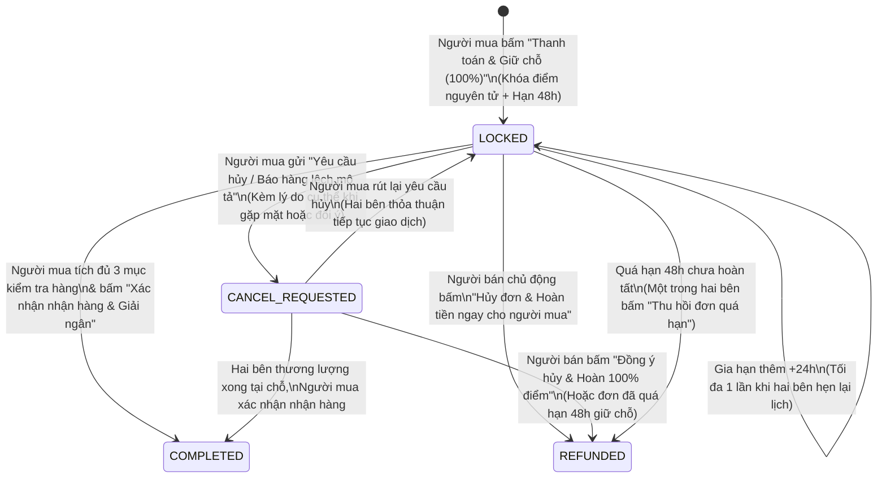

# Kế hoạch Phase 4: Cải tổ Toàn diện UX, User Flow & Quy tắc Giao dịch Escrow (UniCycle)

> [!IMPORTANT]
> **Mục tiêu cốt lõi của Phase 4**:
> Khắc phục triệt để các điểm nghẽn về trải nghiệm người dùng (UX), mật độ chữ dày đặc, luồng giao dịch thiếu bước kiểm tra thực tế và các lỗ hổng logic giữ tiền trên toàn bộ 7 khu vực của ứng dụng trước khi đưa sản phẩm lên môi trường Production/Deploy.
> - **Không cần tài khoản Admin**: Toàn bộ quy trình hủy đơn, gia hạn giữ chỗ và báo cáo sự cố khi gặp mặt đều được thiết kế để **Người mua và Người bán tự thỏa thuận & xử lý trực tiếp trên hệ thống** kèm cơ chế bảo vệ theo thời hạn 48 giờ.
> - **Áp dụng `/ui-ux-pro-max`**: Mọi task có thay đổi giao diện đều tuân thủ chặt chẽ quy chuẩn phân cấp thị giác (Visual Hierarchy), Progressive Disclosure (ẩn chi tiết phụ, chỉ hiện thông tin đúng ngữ cảnh), chuẩn tương phản WCAG AA trên bảng màu 5 sắc độ xanh (`#001B48`, `#02457A`, `#018ABE`, `#97CADB`, `#D6E8EE`) kết hợp nền trắng `#FFFFFF`.

---

## 1. Tổng hợp Audit 7 Khu vực UX & User Flow Cần Cải Tổ

| # | Khu vực | Vấn đề hiện tại (Audit UX & User Flow) | Giải pháp ở Phase 4 |
| :--- | :--- | :--- | :--- |
| **1** | **Luồng Mua hàng & Escrow** | • Chữ `"Đặt cọc giữ chỗ"` gây hiểu nhầm vì thực tế khóa **100% giá trị món hàng**. • Đơn `LOCKED` không có thời hạn (`expires_at`), có thể treo vĩnh viễn. • Người mua có thể tự ý bấm hủy đơn ngay lập tức dù người bán đang trên đường đến điểm hẹn KTX. • Nút `"Xác nhận đã nhận hàng"` bấm 1 chạm là chuyển điểm ngay, thiếu bước nhắc kiểm tra hàng thực tế. | • Đổi thành **"Thanh toán & Giữ chỗ (Escrow 100%)"**. • Thêm hạn giữ chỗ **48 giờ** (`expires_at`) + quyền **Gia hạn thêm 24h**. • Chuyển sang cơ chế **2 bên tự xử lý**: Người mua gửi **Yêu cầu hủy / Báo hàng không đúng mô tả** $\rightarrow$ Người bán **Đồng ý hoàn tiền** (hoặc tự động cho phép hoàn tiền khi hết hạn 48h mà chưa giao dịch). Người bán vẫn có thể chủ động hủy & hoàn tiền ngay cho người mua nếu bận. • Thêm **Checklist kiểm tra 3 mục bắt buộc** trước khi mở khóa nút Giải ngân. |
| **2** | **Ví `/wallet` & `Navbar`** | • Chỉ hiển thị 1 con số duy nhất (`point_balance`), không biết bao nhiêu điểm đang rảnh, bao nhiêu điểm đang khóa trong các đơn đặt mua. • Luồng nạp điểm bấm xác nhận là cộng điểm ngay lập tức (1 bước), thiếu bước tạo mã tham chiếu `PENDING` $\rightarrow$ `CONFIRMED`. • Chưa có ghi chú rõ về cơ chế quy đổi điểm nội bộ (`1 UNIP = 1 VNĐ`). | • Tách bạch 3 chỉ số chuẩn ứng dụng ngân hàng số: **Số dư khả dụng** (`availableBalance`), **Đang giữ trong Escrow** (`lockedBalance`), **Tổng tài sản** (`totalBalance`). • Nâng cấp luồng nạp 2 bước (`PENDING` $\rightarrow$ `CONFIRMED` / `EXPIRED`) có mã tham chiếu `UC-...` và đếm ngược 15 phút. • Bổ sung bộ lọc lịch sử giao dịch theo loại (`Tất cả`, `Tiền vào`, `Tiền ra`, `Đang giữ chỗ`). |
| **3** | **Trang Chi tiết Sản phẩm (`/products/[id]`)** | • Cột phải đang chồng chất **4 khối rời rạc** (Tóm tắt giá + Banner Passport + Khung Escrow + Thông tin liên hệ người bán + Khung chủ bài đăng), gây mỏi mắt và phân tán hành động chính. | • **Gom gọn cột phải xuống tối đa 2 khối**: 1. **Khung Giao dịch & Giữ chỗ hợp nhất** (Giá, Tình trạng, Điểm hẹn KTX, Hành động Escrow + Thông tin liên hệ người bán hiển thị ngay trong luồng). 2. **Thanh chứng thực `UniCycle Passport` & Công cụ chủ tin** thu gọn. |
| **4** | **Đăng tin (`/products/new` & `listing-form.tsx`)** | • Form đăng tin dài trên một cột, đặc biệt khi chọn Đồ điện tử sẽ bung hàng loạt ô thông số khiến sinh viên ngại điền. | • Thiết kế lại bố cục **Chia bước trực quan (3 nhóm gọn gàng)** kèm thanh tiến độ hoàn thiện hồ sơ (`% độ tin cậy Passport`), gom gọn các thông số kỹ thuật vào lưới 2 cột dễ nhìn. |
| **5** | **Trang Passport (`/products/[id]/passport`)** | • Dùng cụm từ `"Sổ đỏ kỹ thuật số"` dễ gây hiểu lầm về mặt pháp lý. • Chưa lưu lại lịch sử các lần chỉnh sửa bài đăng (`product_revisions`), mới chỉ so sánh hash hiện tại. | • Thay thế hoàn toàn `"Sổ đỏ"` bằng **`UniCycle Passport — Hồ sơ Chứng thực Sản phẩm`**. • Trình bày lại thành **3 phần rõ ràng**: (1) Tóm tắt độ tin cậy, (2) Lịch sử phiên bản chỉnh sửa (`product_revisions`) & giao dịch, (3) Chi tiết chữ ký số SHA-256 & On-chain. • Đổi nhãn thành `"Dữ liệu được xác minh toàn vẹn"`. |
| **6** | **Điều hướng chung (`Navbar`, `/profile`, `/profile/my-listings`)** | • Trang `/profile` chưa có thẻ tóm tắt Ví & các đơn đang giữ chỗ. • Khi đăng xuất ở trang công khai bị ép chuyển về `/`, mất ngữ cảnh đang xem. | • Thêm **Thẻ Tóm tắt Ví & Đơn Giao dịch** ngay trong `/profile` và `/profile/my-listings`. • Giữ nguyên trang công khai đang đứng khi đăng nhập/đăng xuất thông qua `safe-redirect`. |
| **7** | **Trang chủ (`/`) & Khám phá (`/products`)** | • Nhiều đoạn chữ giới thiệu dài dòng trên màn hình đầu tiên; thẻ sản phẩm chưa làm nổi bật địa điểm giao dịch (KTX Khu A/B, cơ sở trường) và huy hiệu Passport. | • Tinh gọn Hero Banner, đưa thanh tìm kiếm + chip lọc nhanh danh mục/khu vực KTX lên đầu. • Chuẩn hóa thẻ sản phẩm (`ProductCard`): hiển thị rõ Giá, Tình trạng, Khu vực giao dịch và Huy hiệu `Passport Verified`. |

---

## 2. Sơ đồ Luồng Giao dịch Escrow Mới (Người Mua & Người Bán Tự Xử Lý)

---

## 3. Lộ trình Triển khai Chia nhỏ (6 Atomic Tasks)

> [!NOTE]
> Theo đúng quy tắc trong `AGENTS.md`:
> - Mỗi lần chỉ thực hiện **01 Task duy nhất**.
> - Sau khi hoàn thành từng Task: kiểm tra `npx tsc --noEmit`, hướng dẫn cách chạy thử nghiệm trên trình duyệt, cung cấp lệnh `git add` / `git commit` và **DỪNG LẠI** chờ bạn nghiệm thu.

---

### Task 4.1: Nâng cấp Database Schema (`topup_requests`, `escrow_orders` tự xử lý 2 chiều, `product_revisions`)
- **Mục tiêu**: Bổ sung cấu trúc bảng và các cột dữ liệu hỗ trợ nạp tiền 2 bước, giữ chỗ có thời hạn 48h, cơ chế yêu cầu hủy/báo lỗi giữa Người mua – Người bán (không cần Admin), và lưu lịch sử chỉnh sửa sản phẩm cho Passport.
- **File thay đổi**:
  - `lib/db.ts`
- **Chi tiết công việc**:
  1. Tạo bảng `topup_requests`:
     - `id`, `user_id`, `amount`, `reference_code` (duy nhất, ví dụ `UC-849201`), `status` (`PENDING`, `CONFIRMED`, `EXPIRED`, `CANCELLED`), `tx_hash`, `expires_at`, `confirmed_at`, `created_at`.
  2. Mở rộng bảng `escrow_orders` (tự động migration an toàn bằng `ALTER TABLE` nếu cột chưa tồn tại):
     - Cho phép `status` nhận các giá trị: `'LOCKED'`, `'CANCEL_REQUESTED'`, `'COMPLETED'`, `'REFUNDED'`.
     - Thêm các cột:
       - `expires_at TEXT` (mặc định `+48 giờ` kể từ lúc khóa điểm).
       - `extended_count INTEGER DEFAULT 0` (cho phép gia hạn thêm 24h tối đa 1 lần).
       - `meeting_note TEXT` (ghi chú điểm hẹn/thời gian giao dịch tại KTX/trường).
       - `cancel_reason TEXT` (lý do người mua yêu cầu hủy hoặc báo hàng không đúng mô tả).
       - `cancel_requested_by INTEGER` (ID người gửi yêu cầu hủy).
       - `cancel_requested_at TEXT`.
       - `inspection_checked INTEGER DEFAULT 0` (ghi nhận người mua đã hoàn tất checklist kiểm tra thực tế).
  3. Tạo bảng `product_revisions`:
     - `id`, `product_id`, `editor_id`, `revision_number`, `title`, `price`, `condition`, `specs_json`, `data_hash`, `change_summary`, `created_at`.
     - Tự động khởi tạo Revision `#1` cho các sản phẩm đã có Passport.
  4. Viết hàm helper `getUserWalletSummary(userId)` trả về chính xác 3 con số:
     - `availableBalance`: Số dư khả dụng hiện tại (`users.point_balance`).
     - `lockedBalance`: Tổng `amount` của các đơn `escrow_orders` đang ở trạng thái `LOCKED` hoặc `CANCEL_REQUESTED` của người mua đó.
     - `totalBalance = availableBalance + lockedBalance`.
- **Kiểm thử & Nghiệm thu**:
  - Chạy `npx tsc --noEmit` đảm bảo không lỗi kiểu dữ liệu.
  - Khởi động `npm run dev` để xác nhận migration SQLite chạy êm, không làm mất dữ liệu hiện có.

---

### Task 4.2: API Nạp điểm 2 bước (`PENDING` $\rightarrow$ `CONFIRMED`) & API Escrow Tự Xử Lý Mua–Bán (Atomic Locking + Hạn 48h)
- **Mục tiêu**: Khắc phục triệt để lỗi race-condition khi nhiều người bấm mua cùng lúc, bổ sung API xác nhận nạp điểm 2 bước và API xử lý trọn vẹn vòng đời đơn hàng giữa Người mua và Người bán.
- **File thay đổi**:
  - `app/api/wallet/route.ts`
  - `app/api/wallet/topup/route.ts`
  - `app/api/escrow/route.ts`
  - `app/api/escrow/[id]/route.ts`
  - `app/api/products/[id]/route.ts`
- **Chi tiết công việc**:
  1. **API Ví (`/api/wallet` & `/api/wallet/topup`)**:
     - `GET /api/wallet`: Trả về `availableBalance`, `lockedBalance`, `totalBalance`, danh sách `pendingTopups`, danh sách `activeEscrows` và lịch sử `transactions`.
     - `POST /api/wallet/topup`:
       - `action: "CREATE_INTENT"`: Tạo lệnh nạp `PENDING` kèm mã chuyển khoản `UC-XXXXXX` và hạn 15 phút (`expires_at`).
       - `action: "CONFIRM_TOPUP"`: Kiểm tra lệnh `PENDING` còn hạn $\rightarrow$ thực hiện `mintPointsOnChain` trên Avalanche Fuji $\rightarrow$ cộng điểm vào `point_balance` và chuyển sang `CONFIRMED`.
       - `action: "CANCEL_TOPUP"`: Hủy lệnh nạp đang chờ.
  2. **API Tạo đơn Escrow (`POST /api/escrow`) — Khóa nguyên tử (Atomic Locking)**:
     - Đặt toàn bộ thao tác vào `db.transaction`: sử dụng câu lệnh `UPDATE products SET status = 'RESERVED' WHERE id = ? AND status = 'ACTIVE'` và kiểm tra `result.changes === 1`. Nếu `changes === 0`, báo lỗi ngay *"Sản phẩm vừa được người khác giữ chỗ"*.
     - Trừ điểm nguyên tử `UPDATE users SET point_balance = point_balance - ? WHERE id = ? AND point_balance >= ?`.
     - Lưu `expires_at` (+48h) và `meeting_note` (nếu có).
  3. **API Xử lý đơn Escrow (`POST /api/escrow/[id]`) — Người mua & Người bán tự giải quyết**:
     - `CONFIRM_RECEIPT` (Người mua): Yêu cầu truyền `inspectionConfirmed: true` (đã tích đủ 3 mục kiểm tra hàng) $\rightarrow$ chuyển điểm cho người bán, cập nhật sản phẩm thành `SOLD`, đơn thành `COMPLETED`.
     - `REQUEST_CANCEL` (Người mua): Khi đổi ý hoặc gặp mặt thấy hàng không đúng mô tả, người mua gửi yêu cầu hủy kèm `reason` $\rightarrow$ đơn chuyển sang `CANCEL_REQUESTED`.
     - `APPROVE_CANCEL` (Người bán): Người bán đồng ý yêu cầu hủy của người mua $\rightarrow$ hoàn 100% điểm cho người mua, mở khóa sản phẩm về `ACTIVE`, đơn thành `REFUNDED`.
     - `WITHDRAW_CANCEL` (Người mua): Người mua rút lại yêu cầu hủy để tiếp tục giao dịch (`CANCEL_REQUESTED` $\rightarrow$ `LOCKED`).
     - `SELLER_CANCEL` (Người bán): Người bán chủ động hủy đơn bất cứ lúc nào nếu không thể giao hàng $\rightarrow$ hoàn 100% điểm ngay lập tức cho người mua, sản phẩm về `ACTIVE`.
     - `EXTEND_HOLD` (Người mua hoặc Người bán): Gia hạn thêm `+24 giờ` (tối đa 1 lần) khi hai bên cần dời lịch hẹn tại KTX.
     - `CLAIM_EXPIRED_REFUND` (Người mua hoặc Người bán): Khi `now > expires_at` mà đơn vẫn ở `LOCKED` hoặc `CANCEL_REQUESTED`, cho phép thu hồi đơn quá hạn $\rightarrow$ hoàn 100% điểm về ví người mua và đưa sản phẩm về `ACTIVE`.
  4. **API Cập nhật Sản phẩm (`PUT /api/products/[id]`)**:
     - Chặn chỉnh sửa thông số/giá khi sản phẩm đang `RESERVED` hoặc `SOLD`.
     - Khi sản phẩm đang `ACTIVE` và được chủ bài sửa, tự động ghi thêm bản ghi mới vào `product_revisions` và cập nhật lại `data_hash` mới để Passport luôn minh bạch.

---

### Task 4.3: Thiết kế lại Trang Chi tiết Sản phẩm (`/products/[id]`) & Khung Giao dịch Escrow Hợp nhất *(Sử dụng `/ui-ux-pro-max`)*
- **Mục tiêu**: Giải quyết triệt để tình trạng cột phải có 4 khối chồng chéo và luồng giao dịch thiếu bước kiểm tra thực tế.
- **Skill áp dụng**: `/ui-ux-pro-max` (Progressive Disclosure, Visual Hierarchy, Trust & Verification Checklist).
- **File thay đổi**:
  - `components/escrow-action-card.tsx`
  - `app/products/[id]/page.tsx`
- **Chi tiết công việc**:
  1. **Gom gọn cột phải của `/products/[id]` từ 4 khối xuống đúng 2 khối**:
     - **Khối 1 — Thẻ Giao dịch & Giữ chỗ Hợp nhất (`EscrowActionCard` nâng cấp)**:
       - Hiển thị Giá bán, Tình trạng, Khu vực giao dịch (KTX/Cơ sở) và Số dư khả dụng hiện tại của người mua.
       - Đổi nhãn nút chính thành **"Thanh toán & Giữ chỗ (Escrow 100%)"** kèm ô nhập nhanh *"Ghi chú điểm hẹn (VD: Tối nay 19h tại sảnh KTX Khu B)"*.
       - Khi đơn đang giữ chỗ (`LOCKED` / `CANCEL_REQUESTED`):
         - Hiển thị **Thanh tiến trình 3 bước**: `1. Đã khóa điểm giữ chỗ` $\rightarrow$ `2. Gặp mặt & Kiểm tra hàng` $\rightarrow$ `3. Xác nhận & Giải ngân`.
         - Hiển thị **Đồng hồ đếm ngược hạn 48h** + nút **"Gia hạn +24h"**.
         - Tích hợp sẵn **Thông tin liên hệ người bán / người mua** và ghi chú điểm hẹn ngay trong thẻ này (xóa bỏ khối liên hệ rời rạc bên dưới).
         - **Checklist 3 mục kiểm tra thực tế bắt buộc** dành cho người mua trước khi nút *"Xác nhận nhận hàng & Giải ngân"* được kích hoạt:
           1. `[ ]` Đã kiểm tra ngoại hình & tình trạng thực tế đúng như mô tả.
           2. `[ ]` Đã kiểm tra thông số kỹ thuật khớp với `UniCycle Passport`.
           3. `[ ]` Tôi hiểu sau khi xác nhận, điểm sẽ chuyển ngay cho người bán và không thể hoàn tác.
         - Khu vực **Tự xử lý sự cố / Hủy đơn 2 chiều**:
           - Người mua có nút *"Yêu cầu hủy / Báo hàng không đúng mô tả"* (chọn nhanh lý do: *Hàng thực tế lệch mô tả*, *Không liên lạc được người bán*, *Hai bên thống nhất hủy*).
           - Người bán thấy rõ thông báo khi người mua yêu cầu hủy kèm nút **"Đồng ý hủy & Hoàn 100% điểm"** hoặc chủ động hủy đơn bất kỳ lúc nào.
     - **Khối 2 — Thanh Chứng thực `UniCycle Passport` & Quản trị bài đăng thu gọn**:
       - Gộp huy hiệu `UniCycle Passport` (xem nhanh trạng thái toàn vẹn dữ liệu + nút mở trang Passport chi tiết) và thanh công cụ của chủ bài đăng (Sửa bài / Xóa bài, tự động khóa nút sửa khi đang có người đặt cọc `RESERVED`).

---

### Task 4.4: Thiết kế lại Ví `/wallet`, Thanh điều hướng `Navbar` & Trang Hồ sơ `/profile` chuẩn Ngân hàng số *(Sử dụng `/ui-ux-pro-max`)*
- **Mục tiêu**: Làm rõ số dư khả dụng vs số dư đang khóa trong Escrow, nâng cấp giao diện nạp điểm 2 bước có mã tham chiếu, và kết nối liền mạch giữa Hồ sơ – Ví – Đơn hàng.
- **Skill áp dụng**: `/ui-ux-pro-max` (Fintech/Banking Dashboard Layout, Clear Status Badges, Tabbed Navigation).
- **File thay đổi**:
  - `components/wallet-topup-card.tsx`
  - `app/wallet/page.tsx`
  - `components/navbar.tsx`
  - `app/profile/page.tsx`
  - `app/profile/my-listings/page.tsx`
- **Chi tiết công việc**:
  1. **Thẻ Tổng quan Tài sản trên `/wallet` (3 chỉ số rõ ràng)**:
     - **Số dư khả dụng** (nổi bật nhất, dùng để thanh toán ngay).
     - **Đang giữ trong Escrow** (tổng điểm đang khóa ở các đơn chờ gặp mặt, kèm link bấm xem đơn).
     - **Tổng số dư** (`Khả dụng + Đang giữ`).
     - Thêm dòng thông báo minh bạch: *"Điểm UNIP dùng để thanh toán an toàn qua Escrow trong khuôn viên trường (Tỷ lệ cố định: 1 UNIP = 1 VNĐ)"*.
  2. **Luồng Nạp điểm 2 bước (`components/wallet-topup-card.tsx`)**:
     - Bước 1: Chọn mệnh giá hoặc tự nhập số tiền (tối thiểu `10.000đ`, làm tròn bội số `1.000đ`) $\rightarrow$ Bấm **"Tạo mã nạp điểm"**.
     - Bước 2: Hiển thị thẻ lệnh nạp `PENDING` với mã QR VietQR, nội dung chuyển khoản tự động `UC-XXXXXX`, thời gian hiệu lực 15 phút, cùng 2 nút rõ ràng: **"Tôi đã chuyển khoản — Xác nhận nạp điểm"** và **"Hủy lệnh nạp"**.
  3. **Tab Biến động Số dư & Đơn đang giữ chỗ trên `/wallet`**:
     - Thêm bộ lọc pill chuẩn ngân hàng: `Tất cả` | `Tiền vào (+)` | `Tiền ra (-)` | `Đang giữ chỗ (Escrow)`.
     - Hiển thị danh sách các đơn đang giữ chỗ ngay trong Ví để người dùng bấm thẳng tới trang sản phẩm xử lý mà không phải đi tìm.
  4. **Cập nhật `Navbar` & Trang `/profile`, `/profile/my-listings`**:
     - Trên `Navbar`: Hiển thị `Số dư khả dụng` kèm chấm/nhãn nhỏ nếu đang có đơn giữ chỗ (`+X đang giữ`).
     - Khi bấm Đăng xuất ở các trang công khai (`/`, `/products`, `/products/[id]`): giữ người dùng ở lại đúng trang đó thay vì đẩy về `/`.
     - Trên `/profile` & `/profile/my-listings`: Bổ sung **Thẻ Tóm tắt Ví & Đơn Escrow đang diễn ra** để người mua và người bán theo dõi ngay khi vào hồ sơ cá nhân.

---

### Task 4.5: Chuẩn hóa `UniCycle Passport` (`/products/[id]/passport`) & Tinh gọn Form Đăng tin (`/products/new`) *(Sử dụng `/ui-ux-pro-max`)*
- **Mục tiêu**: Xóa bỏ hoàn toàn thuật ngữ `"Sổ đỏ"` dễ gây hiểu sai, cấu trúc lại trang Passport thành 3 khu vực dễ hiểu có lịch sử phiên bản chỉnh sửa, và làm gọn form đăng tin sản phẩm.
- **Skill áp dụng**: `/ui-ux-pro-max` (Progressive Disclosure, Stepper Form UX, Verification Certificate Layout).
- **File thay đổi**:
  - `app/products/[id]/passport/page.tsx`
  - `components/product-specs-card.tsx`
  - `components/listing-form.tsx`
  - `app/products/new/page.tsx`
- **Chi tiết công việc**:
  1. **Chuẩn hóa toàn bộ thuật ngữ trên `/products/[id]/passport` & `product-specs-card.tsx`**:
     - Thay toàn bộ cụm từ *"Sổ đỏ kỹ thuật số"* bằng **"UniCycle Passport — Hồ sơ Chứng thực Sản phẩm"**.
     - Đổi nhãn *"Chống làm giả 100%"* thành **"Dữ liệu được xác minh toàn vẹn (SHA-256 & Avalanche Fuji)"**.
  2. **Thiết kế lại bố cục Trang Passport gồm 3 phần trực quan**:
     - **Phần 1 — Tóm tắt Độ tin cậy & Cam kết Người bán**: Trạng thái khớp dữ liệu (`Verified`), thông tin người bán, thời점 cấp chứng thực và bảng thông số kỹ thuật gọn gàng.
     - **Phần 2 — Lịch sử Phiên bản Bài đăng (`product_revisions`) & Giao dịch**: Hiển thị rõ sản phẩm đã qua mấy lần cập nhật thông tin/giá (Revision `#1`, `#2`...) và trạng thái giao dịch hiện tại.
     - **Phần 3 — Bằng chứng Kỹ thuật số (Thu gọn trong khung chuyên sâu)**: Đưa các chuỗi mã băm SHA-256, Transaction Hash và liên kết Snowtrace vào khu vực kiểm chứng kỹ thuật có nút Copy nhanh để người dùng phổ thông không bị rối mắt.
  3. **Tinh gọn Form Đăng tin (`components/listing-form.tsx`)**:
     - Chia form thành **3 bước/nhóm trực quan có thanh chỉ báo mức độ hoàn thiện hồ sơ Passport (`%`)**:
       - *Nhóm 1: Thông tin cơ bản & Giá bán* (Tiêu đề, Danh mục, Giá, Tình trạng, Điểm giao dịch KTX/Trường).
       - *Nhóm 2: Thông số cam kết UniCycle Passport* (Hiển thị lưới 2 cột gọn gàng theo đúng danh mục đã chọn, kèm gợi ý điền nhanh bằng chip chọn sẵn).
       - *Nhóm 3: Hình ảnh & Mô tả tình trạng thực tế*.

---

### Task 4.6: Tối ưu UX Trang chủ (`/`) & Trang Khám phá Sản phẩm (`/products`) *(Sử dụng `/ui-ux-pro-max`)*
- **Mục tiêu**: Giảm mật độ chữ gây xao nhãng trên trang chủ, tăng tốc độ tìm kiếm món đồ theo khu vực KTX/Trường và làm nổi bật các sản phẩm đã có chứng thực `UniCycle Passport` hoặc đang được giữ chỗ.
- **Skill áp dụng**: `/ui-ux-pro-max` (Marketplace Grid System, Scannable Product Cards, Sticky Filter Bar).
- **File thay đổi**:
  - `app/page.tsx`
  - `app/products/page.tsx`
  - `components/product-card.tsx` (hoặc nơi render danh sách thẻ sản phẩm)
- **Chi tiết công việc**:
  1. **Tinh gọn Trang chủ (`app/page.tsx`)**:
     - Rút gọn phần chữ giới thiệu ở Hero Section, tích hợp thanh tìm kiếm nhanh kèm các chip danh mục phổ biến (`Giáo trình`, `Laptop / Đồ điện tử`, `Đồ gia dụng KTX`, `Xe đạp / Phương tiện`) ngay trong tầm mắt đầu tiên.
     - Trình bày quy trình **"Mua bán an toàn trong 3 bước"** dưới dạng thẻ ngang ngắn gọn thay vì các đoạn văn dài.
  2. **Nâng cấp Bộ lọc & Thẻ Sản phẩm trên Trang Khám phá (`app/products/page.tsx`)**:
     - Bổ sung bộ lọc nhanh theo **Tình trạng hàng**, **Khoảng giá sinh viên** (`Dưới 100k`, `100k - 500k`, `Trên 500k`) và **Trạng thái** (`Còn hàng`, `Tất cả`).
     - Chuẩn hóa thẻ sản phẩm: giới hạn tiêu đề tối đa 2 dòng (`line-clamp-2`), hiển thị rõ **Giá bán**, **Khu vực giao dịch (KTX/Cơ sở)** và **Huy hiệu `Passport Verified`** gọn đẹp.
- **Kiểm thử tổng thể cuối Phase 4**:
  - Chạy `npx tsc --noEmit` và `npm run build` để đảm bảo toàn bộ dự án sẵn sàng 100% cho giai đoạn Deploy.

