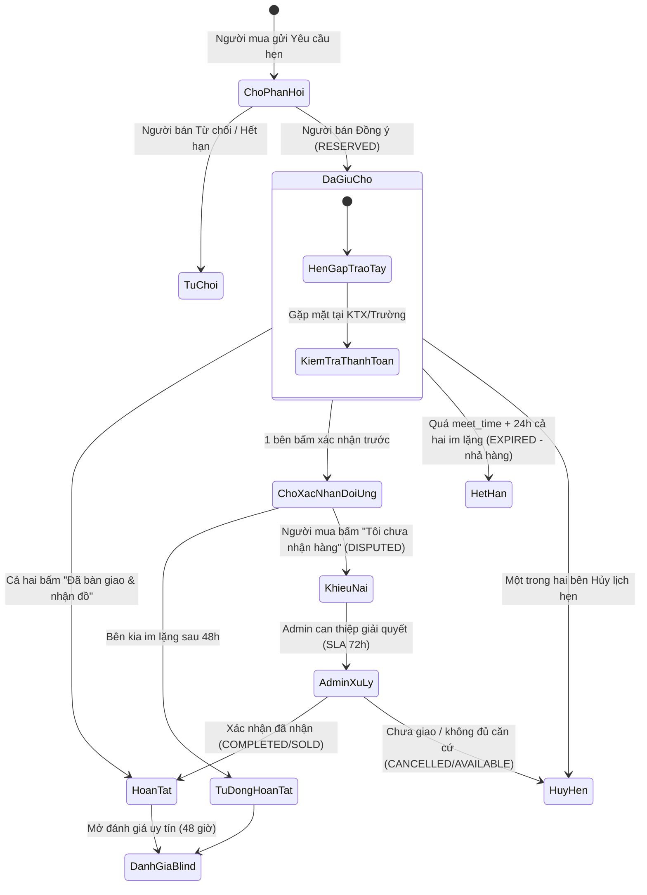

# UniCycle – Hướng Dẫn Thiết Kế Giao Diện & Trải Nghiệm Người Dùng (UI/UX Specification)

Tài liệu này chuẩn hóa toàn bộ thiết kế giao diện (UI) và trải nghiệm người dùng (UX) cho **UniCycle** – Nền tảng mua bán đồ cũ dành cho sinh viên.

## 1. Triết Lý Thiết Kế & Nguyên Tắc UX/UI

### 1.1. Triết lý cốt lõi
- **Mobile-First & 60-Second Listing**: Hơn 85% sinh viên sử dụng smartphone để lướt tìm đồ và chụp ảnh đăng bán ngay tại phòng trọ/KTX. Mọi tác vụ chính phải hoàn thành mượt mà trên màn hình cảm ứng, đăng bán dưới 60 giây.
- **Tin cậy & Minh bạch (Trust by Design)**: Giao diện trực quan làm nổi bật trạng thái xác minh của người bán, lịch sử chuyền tay của món đồ, và đánh giá uy tín có thật từ các giao dịch trước.
- **Tiện lợi không ma sát (Frictionless)**: Không ép sinh viên phải chat trong hệ thống phức tạp; cho phép mở ngay ứng dụng **Zalo** quen thuộc để trao đổi, gửi định vị và gọi điện khi gặp mặt.
- **Tối giản & Đậm chất sinh viên (Clean & Modern)**: Nền trắng tinh khôi kết hợp điểm nhấn dải màu xanh biển đại học; không rườm rà, tập trung 100% vào hình ảnh sản phẩm thật và thông tin giá cả.

---

## 2. Hệ Thống Design Tokens & Visual Guidelines

Kế thừa chuẩn từ [`docs/design.md`](file:///d:/Linh%20tinh/unicycle/docs/design.md):

### 2.1. Bảng màu chuẩn (Color Tokens)

```
┌────────────────────────────────────────────────────────────────────────┐
│  BẢNG MÀU CHỦ ĐẠO UNICYCLE (5 CẤP ĐỘ XANH + NỀN TRẮNG)                │
├────────────────────────────────────────────────────────────────────────┤
│  [1] #001B48  Midnight Navy    - Text chính, tiêu đề H1, Header dark   │
│  [2] #02457A  Deep Ocean Blue  - Tiêu đề section, nhãn giá, border     │
│  [3] #018ABE  Cerulean Blue    - CTA chính, nút đăng tin, focus ring   │
│  [4] #97CADB  Soft Sky Blue    - Gradient stop, viền thẻ nhẹ           │
│  [5] #D6E8EE  Ice Blue Tint    - Nền badge, pill filter, hover card    │
│  [+] #FFFFFF  Pure White       - Nền canvas chủ đạo toàn bộ website    │
│  [!] #0068FF  Zalo Official    - Nút liên hệ qua Zalo (chuẩn thương hiệu)│
└────────────────────────────────────────────────────────────────────────┘
```

### 2.2. Quy chuẩn Typography (Kiểu chữ)
- **Phông chữ chủ đạo**: `Inter` hoặc `Manrope` (Sans-serif hiện đại, tối ưu hiển thị số tiếng Việt và giá tiền).
- **Phân cấp font (Type Scale)**:
  - **Display H1**: `font-bold text-3xl sm:text-4xl text-[#001B48] tracking-tight`
  - **Section H2**: `font-semibold text-2xl text-[#001B48]`
  - **Card Title H3**: `font-medium text-base text-[#001B48] line-clamp-2`
  - **Price Tag**: `font-bold text-lg sm:text-xl text-[#02457A]`
  - **Body / Description**: `text-sm text-slate-600 leading-relaxed`
  - **Caption / Meta**: `text-xs text-slate-400 font-normal`

### 2.3. Hiệu ứng loang màu Hero (Hero Gradient Bleed)
Phần đầu của Trang chủ sử dụng kỹ thuật gradient chuyển màu:
- Chạy từ `#001B48` sang `#02457A` và `#018ABE`, kết hợp lớp phủ làm mờ ánh sáng (blur glow `#97CADB`) loang nhẹ dần xuống nền trắng `#FFFFFF` bên dưới.
- Giúp tạo ấn tượng thị giác công nghệ, trẻ trung nhưng vẫn giữ được sự tinh tế, không làm tối giao diện.

---

## 3. Kiến Trúc Điều Hướng (Navigation Patterns)

Kế thừa trải nghiệm điều hướng thuận tiện từ `index.html` và chuẩn mobile app:

```
[DESKTOP NAVIGATION - Sticky Header & Topbar]
┌─────────────────────────────────────────────────────────────────────────────┐
│ 🎓 Ký túc xá: Làng Đại Học Thủ Đức ▼ | ⚡ Hỗ trợ sinh viên 24/7 | Góc 0đ Cho Tặng │
├─────────────────────────────────────────────────────────────────────────────┤
│ [UniCycle Logo]   [🔍 Tìm giáo trình, quạt, bàn KTX...]   [Khu vực: KTX Khu B ▼]  │
│                   [Đăng bán +]   [📋 Đơn hẹn (2)]   [👤 Avatar Google / Đăng nhập]│
└─────────────────────────────────────────────────────────────────────────────┘

[MOBILE NAVIGATION - Bottom Bar (Cố định dưới cùng màn hình)]
┌──────────────┬──────────────┬──────────────┬──────────────┬────────────────┐
│   🏠 Trang chủ│  🔍 Khám phá  │   ➕ Đăng tin │   📋 Đơn hẹn │   👤 Tài khoản │
└──────────────┴──────────────┴──────────────┴──────────────┴────────────────┘
```

- **Desktop**: Header dính cố định (sticky) với ô tìm kiếm trung tâm lớn, dropdown chọn Trường/KTX nhanh, nút Đăng bán nổi bật màu `#018ABE`.
- **Mobile**: Thanh điều hướng 5 nút ở đáy màn hình; nút **"Đăng tin"** đặt chính giữa với hình tròn nổi bật tạo điểm nhấn hành động.

---

## 4. Đặc Tả UX & Bố Cục Chi Tiết Từng Màn Hình

### 4.1. Trang Chủ (Homepage UX)

Trang chủ được thiết kế theo phễu chuyển đổi giúp người mua tìm đồ nhanh nhất:

1. **Hero Section (Loang màu)**:
   - Câu định vị: *"Chợ đồ cũ sinh viên – Tiết kiệm, tin cậy & trao tay tận cổng trường"*.
   - Thanh tìm kiếm thông minh: Tìm kiếm theo từ khóa kèm bộ chọn nhanh trường ĐH/KTX (VD: KTX ĐHQG Khu A/B, ĐH Bách Khoa, ĐH Kinh Tế...).
2. **Category Carousel / Grid (Danh mục trực quan)**:
   - Các biểu tượng bo góc nền `#D6E8EE`, icon màu `#018ABE`:
     - 📚 Giáo trình & Sách học
     - 🪑 Bàn ghế & Tủ KTX
     - 🔌 Đồ gia dụng & Quạt điện
     - 💻 Đồ điện tử & Phụ kiện
     - 🛵 Xe đạp & Xe máy sinh viên
     - 🎁 Tặng miễn phí (0đ)
3. **Bộ lọc nhanh (Quick Filter Pills)**:
   - `[Tất cả]` `[Gần bạn]` `[Có lịch sử đồ vật]` `[Dưới 100k]` `[Đồ tặng 0đ]`.
4. **Các Phân Đoạn Trọng Tâm Trên Trang Chủ (Curated Sections - Kế thừa từ index.html)**:
   - **⚡ Mới đăng quanh KTX của bạn**: Tự động ưu tiên hiển thị các tin đăng trong bán kính trường/KTX đã chọn.
   - **📚 Giáo trình & Sách học đại học**: Phân mục chuyên biệt cho sách học, tài liệu ôn thi chuyển giao giữa các khóa.
   - **🔌 Đồ gia dụng KTX thiết yếu**: Quạt điện, nồi cơm mini, bàn học gấp, ấm siêu tốc.
   - **🎁 Góc 0đ – Sinh viên chia sẻ**: Nơi các bạn sinh viên năm cuối tặng đồ miễn phí cho tân sinh viên khó khăn.
   - **🏆 Sinh viên bán đồ uy tín tuần**: Top người bán có điểm đánh giá 5⭐ và phản hồi nhanh.

---

### 4.2. Thẻ Sản Phẩm Chuẩn (Product Card UX)

Mỗi thẻ sản phẩm được kế thừa thiết kế e-commerce trực quan từ `index.html`:

```
┌───────────────────────────────────────┐
│ [Ảnh sản phẩm (Tỉ lệ 1:1 hoặc 4:3)]   │
│ ┌───────────────┐ ┌─────────────────┐ │
│ │ 🌟 Đã xác minh│ │ 📜 Có Passport  │ │
│ └───────────────┘ └─────────────────┘ │
│ [🤍 Yêu thích]         [👁️ Xem nhanh] │
├───────────────────────────────────────┤
│ Bàn học gấp gọn sinh viên KTX         │
│ 120.000 đ                             │
│ 📍 KTX Khu B, ĐHQG TP.HCM · 2 giờ trước│
├───────────────────────────────────────┤
│ [ 💬 Nhắn Zalo ]     [ 📅 Đặt hẹn ]   │
└───────────────────────────────────────┘
```

- **Huy hiệu (Badges)**:
  - `🌟 Sinh viên đã xác minh`: Nền xanh nhạt `#D6E8EE`, chữ xanh `#02457A`.
  - `📜 Có Passport`: Biểu thị món đồ có lịch sử chuyền tay minh bạch.
- **Thanh thao tác nhanh (Quick Action Bar - P1)**:
  - Nút **Yêu thích (Wishlist)** & Nút **Xem nhanh (Quick View)**: Đánh dấu là tính năng mở rộng ở P1 nhằm giữ phạm vi MVP tập trung và tinh gọn nhất.
- **Tương tác**: Hover trên Desktop viền thẻ đổi màu sang `#97CADB`, nâng nhẹ thẻ tạo chiều sâu (`shadow-md`).

---

### 4.3. Trang Chi Tiết Sản Phẩm (Product Detail Page - PDP)

Trang quyết định chuyển đổi giao dịch, giải quyết triệt để bài toán **Tin cậy** và **Liên lạc**:

#### A. Cụm Hành Động Liên Lạc (Dual CTA - Điểm đột phá MVP)
Thay vì bắt sinh viên chờ đợi trong hệ thống chat xa lạ, UniCycle cung cấp 2 lựa chọn liên hệ rõ ràng:

1. **Nút "Nhắn qua Zalo" (Ưu tiên số 1 - Màu xanh Zalo `#0068FF`)**:
   - Khi bấm trên Mobile: Mở ứng dụng Zalo trên điện thoại (`zalo.me/<sdt_người_bán>`).
   - Tự động điền nội dung mẫu: *"Chào bạn, mình thấy tin đăng [Tên món đồ] giá [Giá tiền] trên UniCycle, bạn còn đồ không ạ?"*.
   - **Giao diện Modal trên Desktop (Zalo Contact Dialog)**:
     ```
     ┌────────────────────────────────────────────────┐
     │ 💬 LIÊN HỆ QUA ZALO                            │
     │ Người bán: Bạn Minh (ĐH Bách Khoa)            │
     ├────────────────────────────────────────────────┤
     │       ┌──────────────┐                         │
     │       │ [ MÃ QR ZALO ]                         │
     │       │   (Quét ngay)│                         │
     │       └──────────────┘                         │
     │  Quét mã QR bằng ứng dụng Zalo trên điện thoại │
     │  hoặc:                                         │
     │  [ 📱 Mở Zalo Web ]   [ 📋 Copy Số điện thoại ]│
     └────────────────────────────────────────────────┘
     ```
2. **Nút "Đặt lịch hẹn xem hàng" (Nút thứ hai - Nền `#018ABE`)**:
   - Mở popup chọn:
     - Giá đề xuất (nếu muốn thương lượng nhẹ).
     - Địa điểm đề xuất (Cổng KTX, Nhà ăn, Thư viện trường...).
     - Khung giờ có thể gặp mặt.
   - Khi gửi: Người bán nhận thông báo; nếu đồng ý, sản phẩm chuyển sang trạng thái **Đang giữ chỗ (Reserved)** để không bị người khác mua mất.

#### B. Khối Hồ Sơ Người Bán (Seller Trust Box)
- Avatar người bán, Tên hiển thị, Trường đại học.
- Đánh giá sao (VD: `⭐ 4.9 (18 đánh giá)`).
- Tỷ lệ phản hồi & Thời gian phản hồi trung bình.
- Huy hiệu: `Đã xác thực Google` & `Sinh viên đã xác minh`.

#### C. Khối Lịch Sử Đồ Vật (Product Passport Timeline)
Hiển thị ngay trên trang chi tiết sản phẩm để người mua kiểm chứng:

```
┌─────────────────────────────────────────────────────────────┐
│ 📜 LỊCH SỬ ĐỒ VẬT (PRODUCT PASSPORT)                        │
│ Mã định danh: #UC-84920 · Tình trạng: Hợp lệ                │
│                                                             │
│ ● Chủ #1: Bạn Hoàng (ĐH Bách Khoa) · Tháng 09/2024          │
│   │                                                         │
│   ▼ Bàn giao trực tiếp tại KTX Bách Khoa                    │
│ ● Chủ #2: Bạn Mai (ĐH KH Tự Nhiên) · Tháng 02/2025         │
│   │                                                         │
│   ▼ Bàn giao trực tiếp tại KTX Khu B                        │
│ ● Chủ #3: Bạn đang xem món đồ này!                          │
│                                                             │
│ [Mã QR số định danh · Quét trên màn hình điện thoại để đối chiếu] │
│ 🔗 Xác minh on-chain: Sắp có ở giai đoạn P1 (Avalanche Fuji) │
└─────────────────────────────────────────────────────────────┘
```

#### D. Hộp Lưu Ý An Toàn (Safety First Notice)
- Lời nhắc nhở thân thiện: *"Khuyến nghị sinh viên gặp mặt giao dịch tại nơi công cộng (cổng trường, căng tin, sảnh KTX), kiểm tra đồ cẩn thận trước khi thanh toán trực tiếp. Không chuyển tiền đặt cọc trước."*

---

### 4.4. Quy Trình Đăng Bán Dưới 60 Giây (Post a Listing UX)

Tối ưu form 1 trang duy nhất (Single-step scroll) trên điện thoại:

1. **Tải ảnh thật**: Bấm nút chụp ảnh hoặc chọn từ thư viện (tối đa 5 ảnh). Tự động nén ảnh tại máy client để đăng nhanh không tốn 4G.
2. **Thông tin cơ bản**:
   - Tên món đồ (kèm gợi ý điền nhanh: Giáo trình, Quạt đứng, Bàn gỗ...).
   - Danh mục & Tình trạng (Mới 99%, Còn tốt, Đã cũ).
   - Giá bán (hoặc tích chọn `Tặng miễn phí 0đ`).
3. **Khu vực bàn giao**: Chọn Trường đại học / Cụm KTX để người mua cùng trường dễ tìm.
4. **Tùy chọn liên hệ Zalo & Passport**:
   - Nhập Số điện thoại Zalo (có tuỳ chọn ẩn số thật, chỉ mở link Zalo).
   - Công tắc bật: `[x] Tạo Hộ chiếu đồ vật (Passport) miễn phí cho món đồ này`.
5. **Nút "Đăng bán ngay"**: Nổi bật màu `#018ABE`.

---

### 4.5. Luồng Quản Lý Giao Dịch & Hoàn Tất Trong 48 Giờ (Orders & Completion UX)

Rút gọn chu kỳ so với bản thiết kế cũ nhằm phản ánh đúng thực tế giao dịch sinh viên:



- **Quy tắc 48 giờ & Timeout**:
  - Khi một bên bấm "Đã nhận hàng/Đã giao", bên còn lại có **48 giờ** để xác nhận đối ứng. Trong thời gian này, nếu người mua chưa nhận được hàng có thể bấm nút **"Tôi chưa nhận hàng" (Khiếu nại)** để chặn auto-complete và chuyển Admin xử lý. Quá 48h im lặng, đơn tự chuyển `AUTO_COMPLETED` (BR13).
  - Nếu quá lịch hẹn (`meet_time`) + **24 giờ** mà không bên nào bấm xác nhận, đơn tự động chuyển `EXPIRED` và nhả trạng thái giữ chỗ về `AVAILABLE` (BR37).
  - Sau khi hoàn tất, hai bên có **48 giờ** để gửi đánh giá bí mật (blind review) cho nhau trước khi công khai điểm uy tín.

---

### 4.6. Màn Hình "Đồ Của Tôi" & Mã QR Passport (My Items UX)

- Khi mua thành công một món đồ có Passport, món đồ sẽ tự động chuyển vào mục **"Đồ của tôi"** trong tài khoản người mua.
- **Tính năng độc đáo**:
  - Xem lại toàn bộ timeline lịch sử của món đồ.
  - Hiển thị **Mã QR Passport số trực tiếp trên màn hình điện thoại**: Khi gặp mặt giao dịch hoặc chuyển nhượng, người bán chỉ cần mở app/web cho người mua quét đối chiếu ngay tức thì (không cần in dán vật lý).
  - **Nút "Bán lại" (Resell 1-click)**: Khi hết năm học không dùng nữa, sinh viên bấm nút này hệ thống tự tạo tin đăng mới và kế thừa toàn bộ lịch sử uy tín của các đời chủ trước!
  - **Chuyển quyền trực tiếp (P1)**: Cho tặng bạn bè bằng mã số / QR có hạn 24 giờ mà không cần qua luồng mua bán.

---

### 4.7. Quy Chuẩn Modal & Popup Tương Tác (Dialog UX Patterns)

1. **Modal Liên Hệ Zalo (Desktop)**:
   - Tối ưu cho sinh viên duyệt web bằng laptop: Hiển thị mã QR Zalo to, rõ nét giữa màn hình kèm nút "Mở Zalo Web" và nút "Sao chép số điện thoại" (qua route trung gian bảo mật `/api/zalo/[listingId]`).
2. **Modal Đặt Lịch Hẹn Xem Hàng**:
   - Chọn nhanh các địa điểm công cộng an toàn phổ biến: Cổng KTX Khu A/B, Nhà ăn trung tâm, Thư viện trường, Cổng chính Đại học.
   - Chọn khung giờ hẹn: Sáng (8h-11h), Trưa (11h-13h), Chiều (13h-17h), Tối (17h-20h).
3. **Modal Đánh Giá Bí Mật 48 Giờ**:
   - Chấm sao trực quan (1–5⭐) kèm các tag nhanh: *"Đồ đúng mô tả"*, *"Đúng giờ"*, *"Thân thiện"*, *"Nhiệt tình"*.
   - Khung nhận xét ngắn gọn, thông báo rõ: *"Đánh giá của bạn sẽ được giữ bí mật và chỉ hiển thị khi cả hai cùng hoàn tất hoặc sau 48 giờ"*.

---

## 5. Quy Chuẩn Trạng Thái Tương Tác & Phản Hồi (Micro-interactions)

- **Trạng thái tải (Loading)**: Dùng **Skeleton Screens** (khung mờ màu `#D6E8EE`) cho thẻ sản phẩm và thông tin chi tiết; tuyệt đối không dùng spinner xoay tròn che toàn màn hình gây khó chịu.
- **Phản hồi hành động (Toast Notification)**: Thông báo màu xanh dịu khi copy link Zalo thành công hoặc gửi lịch hẹn thành công.
- **Trạng thái rỗng (Empty States)**: Khi tìm kiếm không có kết quả, hiển thị hình vẽ minh họa sinh viên vui tươi kèm gợi ý: *"Thử tìm với từ khóa khác hoặc chuyển sang trường đại học lân cận"*.
- **Tương thích thiết bị**: Kiểm thử chuẩn trên cả màn hình di động phổ thông (375px - 414px) và màn hình máy tính (1024px - 1440px).

---

## 6. Lộ Trình Hiện Thực Hóa (Implementation Checklist)

- [ ] Cấu hình Tailwind CSS với hệ màu tokens từ `design.md`.
- [ ] Xây dựng Header Responsive & Bottom Navigation Bar cho Mobile.
- [ ] Phát triển Khối Hero loang màu (Gradient Bleed) và Search Bar thông minh.
- [ ] Thiết kế Component Thẻ Sản Phẩm (Product Card) tích hợp nhãn Zalo & Passport.
- [ ] Triển khai Trang Chi Tiết Sản Phẩm (PDP) với Dual CTA (Nút Zalo + Đặt lịch hẹn).
- [ ] Tích hợp Form đăng bán tối giản dưới 60 giây.
- [ ] Hoàn thiện luồng xác nhận đơn và đánh giá 48 giờ kèm xử lý khiếu nại.
- [ ] Xây dựng trang Lịch sử đồ vật `/passport/[id]` và màn hình "Đồ của tôi" `/my-items`.
- [ ] Phát triển tính năng Bán lại 1-chạm (Resell) kế thừa Digital Passport.
- [ ] Xây dựng giao diện Xác minh sinh viên `/verify-student` và trang Admin cơ bản.

